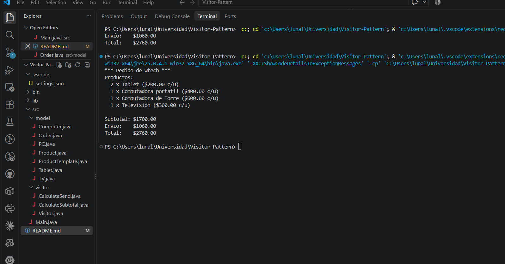

# Wtech Sales Calculator
> Introduction to the Visitor Design Pattern
> Behavioral Pattern

## Description
A small sales calculator for Wtech, a technology store, built with the **Visitor** design pattern. It computes the subtotal and the shipping cost of an order made up of different types of products (tablets, laptops, desktop computers and TVs) without the product classes knowing how those calculations are done.

### Why use the Visitor pattern in this case?
Visitor is a behavioral pattern that lets you add new operations to a set of objects of different types without modifying their classes. The operation is moved into a separate object (the visitor), and each element just "accepts" it and tells it which method to run. This mechanism is called **double dispatch**.

This fits the needs of the context: every product has a different price and weight, and the order must compute different results over them (subtotal, shipping, and in the future taxes, discounts or reports). If those calculations lived inside the product classes, or inside one big method full of `if/else` or `instanceof` checks, every new rule would force us to modify all the classes. With Visitor, a new rule is just a new visitor.

**Shipping rule:** for every 100 grams of weight, the product pays 2% of its price.

```
shippingPercentage = (weightInGrams / 100) * 2
shippingCost       = price * shippingPercentage / 100
```

| Product  | Price (USD) | Weight (g) |
|----------|-------------|------------|
| Tablet   | 200         | 250        |
| Laptop   | 400         | 1000       |
| Desktop  | 600         | 6000       |
| TV       | 300         | 4000       |

## Components

1. **Product** *Element*: Interface common to all products. Declares `accept(Visitor visitor)`.

2. **Tablet, PC, Computer, TV** *Concrete Elements*: Different implementations of the element interface.
- They only store data (name, price and weight), inherited from the abstract class `ProductTemplate`.
- Each one implements `accept()` by calling `visitor.visit(this)`, so the product itself tells the visitor which method to run (double dispatch).

3. **Visitor** *Visitor*: Interface that declares one `visit()` method for each concrete product type, plus `getResult()`.

4. **CalculateSubtotal, CalculateSend** *Concrete Visitors*: Contain the calculation logic.
- `CalculateSubtotal` adds up the prices.
- `CalculateSend` applies the shipping rule to each product.
- Each visitor accumulates its own result, so a new instance is used for every calculation.

5. **Order** *Object Structure*: Collection of products with their quantities. It validates that the quantity is greater than zero and traverses its products applying a visitor.

6. **Main** *Client*: Executes the test scenario. It never asks which type each product is: it only asks the order to accept a visitor and reads the result.

## Project Structure
```
src/
├── model/
│   ├── Product.java
│   ├── ProductTemplate.java
│   ├── Tablet.java
│   ├── PC.java
│   ├── Computer.java
│   ├── TV.java
│   └── Order.java
├── visitor/
│   ├── Visitor.java
│   ├── CalculateSubtotal.java
│   └── CalculateSend.java
├── img/
│   └── Output.png
└── Main.java
```

## How to Run
Requirements: JDK 8 or higher.

From the project root folder:

```bash
javac -d bin src/Main.java src/model/*.java src/visitor/*.java
java -cp bin Main
```

Test scenario: 2 tablets, 1 laptop, 1 desktop computer and 1 TV. Expected result: subtotal **$1700**, shipping **$1060** and total **$2760**.

## Console Output
